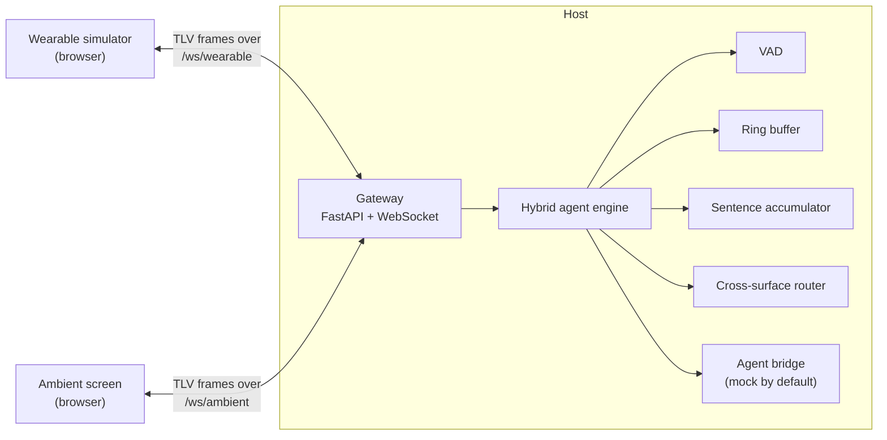

# Project PA

[](https://github.com/uditdaftary/project-pa/actions/workflows/ci.yml)


Software stack for a glasses-style wearable AI agent: a binary framing protocol, a local audio and routing engine, a WebSocket gateway, and two browser clients that stand in for the hardware.

## What problem it solves

The target device is a pair of smart glasses with a small private display, a bone-conduction microphone and an open-ear speaker. Hardware does not exist yet, so the interesting problems have to be solved in software first:

- How does a wearable talk to a host over WebSocket now and BLE later without a second protocol?
- How does the agent decide whether an answer belongs on the 640x200 glasses display or on a nearby screen, and whether audio goes to the ear or the room?
- How does the agent stop talking cleanly when the wearer interrupts?

Project PA answers these with a single wire protocol, a router that follows gaze and content size, and a ring buffer with a click-free drain. A wearable simulator and an ambient screen receiver run in the browser, so the whole loop can be exercised with no hardware.

## Features

- **Framing protocol** (`core/`): 12-byte header (magic `PA`, version, message type, sequence, length, CRC-16-CCITT), 10 message types, a streaming parser that handles split and concatenated frames, strict CRC checks and a 4 MB payload cap. Payload schemas are pydantic models.
- **Audio ring buffer** (`agent_engine/local/ring_buffer.py`): thread-safe int16 buffer with an atomic drain that applies a 2 ms half-cosine fade, generation fencing against stale writes, and a playhead counter.
- **Voice activity detector** (`agent_engine/local/vad.py`): 30 ms frames, 80 Hz high-pass filter with DC blocker, adaptive noise floor, onset and hangover logic, and fusion of a bone-conduction energy signal for whispers.
- **Sentence accumulator** (`agent_engine/local/sentence_parser.py`): splits streaming text into short cards for the HUD without breaking on abbreviations, initials or decimals.
- **Cross-surface router** (`agent_engine/router.py`): look-to-cast from a gaze vector or gesture, auto-revert only for gaze-initiated casts, content-density routing (code blocks, tables, long text go to the ambient screen), and whisper detection that pins audio to the private ear.
- **Gateway** (`gateway/`): FastAPI app with `/ws/wearable`, `/ws/ambient` and a compatibility `/ws` endpoint, per-client outbound queues that drop audio first under backpressure, and `/health`, `/status` and `/route` REST endpoints.
- **Browser clients**: a wearable simulator (`simulator/`) with a 640x200 canvas HUD, microphone input, IMU sliders and gesture buttons, and an ambient screen receiver (`ambient_screen/`) that renders Markdown and card content.
- **Tests**: 75 pytest tests covering the protocol, engine, gateway and end-to-end flows.

## Architecture



Flow for one voice turn: the wearable streams PCM audio uplink frames, the VAD detects speech and end of turn, the bridge produces a reply (text, audio and optional tool calls), the router picks the display surface and audio destination, and the gateway fans the result out to the connected clients. If the wearer speaks while reply audio is playing, the ring buffer is drained with a short fade.

## Tech stack

Python 3.11+, FastAPI, Uvicorn, pydantic, NumPy, pytest, ruff. The browser clients are plain HTML, CSS and JavaScript with Canvas and Web Audio.

## Quickstart

```bash
git clone https://github.com/uditdaftary/project-pa.git
cd project-pa
python -m venv .venv
source .venv/bin/activate        # Windows: .venv\Scripts\activate
pip install -e ".[dev]"

python -m pytest -q              # 75 tests
ruff check .                     # correctness-only rule set, see pyproject.toml

python -m gateway.server         # starts the gateway
```

The gateway prints its URL. Open `/simulator/` for the wearable and `/ambient/` for the ambient screen, ideally in two browser windows. In the simulator, use the prompt buttons (for example "Show metrics on screen") or the text box to run a turn.

## Project layout

```
core/             Message schemas and TLV framing (pack, unpack, streaming parser)
agent_engine/
  local/          Ring buffer, VAD, sentence accumulator
  cloud/          Agent bridge (mock mode, optional LiveKit hook)
  router.py       Display and audio routing rules
  engine.py       Wires the pieces together
gateway/          FastAPI server and WebSocket fan-out
simulator/        Wearable simulator (HTML, CSS, JS)
ambient_screen/   Ambient screen receiver (HTML, CSS, JS)
tests/            pytest suite
docs/             Design decisions, bug report, development notes
```

## Configuration

| Variable | Default | Purpose |
| --- | --- | --- |
| `PA_GATEWAY_HOST` | `127.0.0.1` | Interface the gateway binds to |
| `PA_GATEWAY_PORT` | first free port from 8080 | Fixed port for the gateway |

The gateway only accepts cross-origin browser requests from `localhost` and `127.0.0.1`. There is no authentication, so do not expose it on a public interface.

## Limitations and roadmap

- **No hardware.** The optics, speaker, microphone and battery figures in `docs/design-decisions.md` are design targets from research, not built or measured.
- **The agent is a mock.** `LiveKitBridge` defaults to a mock mode that matches keywords in the query ("cast", "speaker", "status") and returns canned text plus a two-tone chime. In `livekit` mode it only checks that the `livekit` package imports and then marks itself connected; no LiveKit session is created. There is no speech recognition, language model or speech synthesis in this repository.
- **PCM only.** The header can carry `opus` and `lc3` codec ids, but the engine assumes 16-bit PCM and has no decoders.
- **Single shared engine.** The gateway uses one module-level engine instance, so it models one wearer.
- **Lint gate is narrow.** CI runs ruff with a correctness-only rule set; the existing code has unused imports that are not yet enforced.

Next steps, in order: replace the mock bridge with a real speech and language pipeline, add codec decoding, and make the engine per-connection.

## License

MIT. See [LICENSE](LICENSE).
